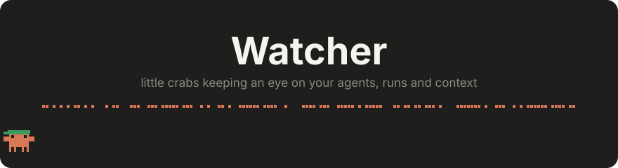
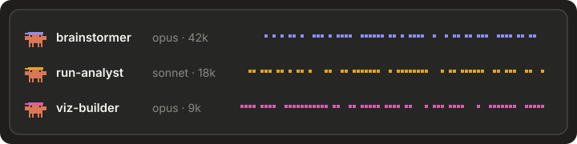
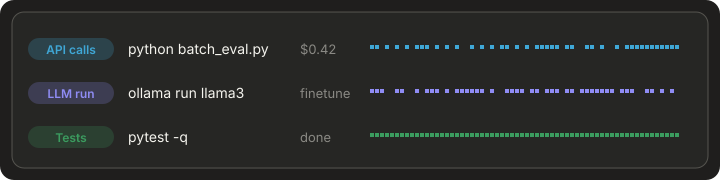

<p align="center">
  
</p>

<p align="center">
  <b>Claude Code plugins by AE-Emmanuel</b><br>
  
  
  
</p>

# 🦀 Watcher

Little crabs that keep an eye on things while Claude works. Watcher puts quiet, live bands above the prompt for **subagents**, **background runs** and **context**. They show up only while something is happening and tidy themselves away 10 minutes after.

> **Costs you zero usage.** Watcher only draws on screen. It never adds a single token to the model's context.

Watcher is three plugins. Install all of them, or just the one you want.

### 🧑‍🤝‍🧑 agent-watcher


Every running subagent gets its own walking crab in a coloured bandana, with its model and tokens. Press **`a`** for the full panel with live progress.

### 🏃 run-watcher


Shows background tasks Claude starts, each sorted into **API calls, LLM run, Experiment, Tests, Build, Server, Install, Data** or **Script**, with tags and a cost tag. Output is read only when you expand a task, and **open log ↗** jumps to the file. Press **`r`** for the panel.

### 🧠 context-watcher


Shows the model and its effort, a big context bar and the 5-hour usage window with pace. The bar shimmers left to right as context grows and runs backwards when a compaction frees space.

**Stacking:** the watcher bands always sit above the context card. With two or more up, press **`h`** to pause them.

## 📦 Install

```
/plugin marketplace add AE-Emmanuel/claude-plugins
/plugin install agent-watcher@ae-plugins
/plugin install run-watcher@ae-plugins
/plugin install context-watcher@ae-plugins
/reload-plugins
```

## ⚙️ Settings

Set these in `/plugin` → pick the plugin → **Configure**.

| Plugin | Setting | Default |
| --- | --- | --- |
| all | `lingerMinutes`: how long a band stays after activity | 10 |
| agent-, run-watcher | `bandRows`: rows shown before the rest fold into `+N` (1–4) | 2 |
| run-watcher | `extraPatterns`: your own category words, e.g. `Experiment: run_thesis; API calls: my_batch` | — |
| context-watcher | `showUsagePace`: show pace against the 5-hour window | on |

## 🎨 Design rules

- Shows nothing unless it's relevant, and hides 10 minutes after activity.
- No clutter, no "completed" text, no flicker.
- Animations only breathe and twinkle. Real progress appears only when you open a panel.

## 💛 Credits & inspiration

- **[savvy-progress](https://github.com/JohnnyVizz/claude-kit) by JohnnyVizz** (MIT). The pixel Clawd crab and the dotted twinkling track are adapted from it.
- **[context-bar](https://github.com/hamzafer/claude-code-mods/tree/main/mods/context-bar) by hamzafer**. It inspired the layout of the context card.
- **Claude Code's own "ultrathink" shimmer**. It inspired the bar's shimmer.
- **Clawd**, Claude's crab mascot, the star of the show.

## 📜 License

MIT. See [LICENSE](LICENSE) and [CHANGELOG](CHANGELOG.md).
